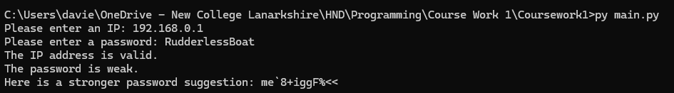
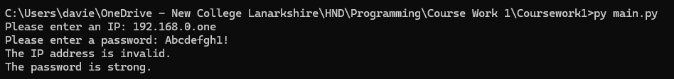

# Student Information
- Reagan Mcluckie
- New College Lanarkshire Motherwell
- B01888719

# How The Program Works
The program does the following

- validates a password ensuring it has at least 1 character, digit and symbol
- ensures that an IP address is valid making sure there is 3 dots/periods, 4 octets and the range is between 0 and 255
- Generates a strong password using the random and string imports

# Imports
## String
Uses the string module for a list of symbols using string.ascii_letters, string.digits and string.punctuation to generate a strong random password.

## Random
Uses random.randint() to make the password a random length between 10 to 16 characters long

Windows Default
```
python main.py
```

Linux / macOS
```
python3 main.py
```

Windows Launcher
```
py main.py
```

# Testing Images


