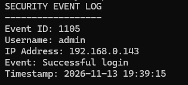
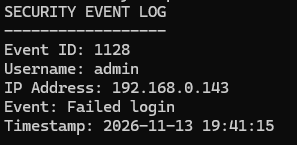

# Student Information
- Reagan Mcluckie
- New College Lanarkshire Motherwell
- B01888719

# How The Program Works
This program generates a log looking something like this if the login is successful


or something like this if it is unsuccessful


## The program also uses some imports
### random
This import is used to generate the event id being a random number between 1000 and 9999

### socket
This import is used to get the local ip address of the device being used

### datetime
This import is being used to generate the timestamp

# How To Run The Program
Depending on your operating system you can use one of these commands to run the program if you open a command prompt in the directory of the script

Windows Default
```
python Task2.py
```

Linux / macOS
```
python3 Task2.py
```

Windows Launcher
```
py Task2.py
```

# Testing Images



