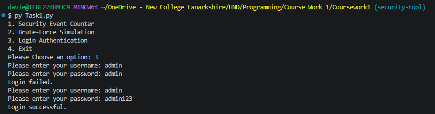
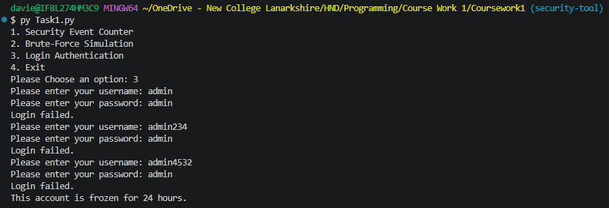
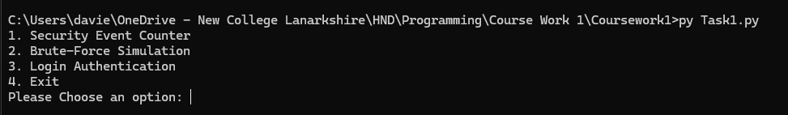

# Student Information
- Reagan Mcluckie
- New College Lanarkshire Motherwell
- B01888719

# How The Program Works
This program has the following functionalities
- Security Event Counter
- Brute-Force Simulation
- Login Authentication
- Exit

## Security Event Counter
This asks the user to enter a password 10 times. The correct password is stored in a variable inside of the function. It will count the number of times the password was entered correctly☑️ and incorrectly✖️. It also displays the percentage of incorrect passwords entered and if the percentage is more than 50% it will make an alert

## Brute-Force Simulation
This asks the user to enter a password with a defined password in a variable. There is a maximum amount of attempts the user can try and when they reach the maximum the user is stopped being asked to enter a password and it lets them know that they have entered the maximum amount of attempts

## Login Authentication
Prompts the user to enter a username and password and compares it to the username and password stored in the function. It gives you a maximum number of login attempts and if you fail to login within the maximum attempts it stops asking you for login details and displays a message that the account has been frozen for 24 hours

## Exit
Allows the user to exit the program printing "Thank you for using the security tool"


# How To Run The Program
Depending on your operating system you can use one of these commands to run the program if you open a command prompt in the directory of the script

Windows Default
```
python Task1.py
```

Linux / macOS
```
python3 Task1.py
```

Windows Launcher
```
py Task1.py
```

# Testing Images




