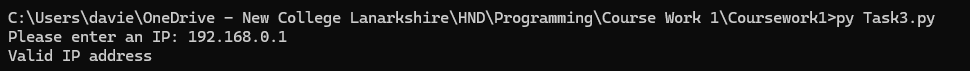
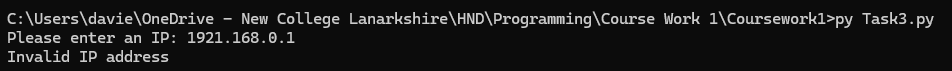
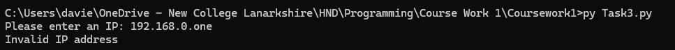

# Student Information
- Reagan Mcluckie
- New College Lanarkshire Motherwell
- B01888719

# How The Program Works
This program validates if an IP address is valid or not using the validate_ip() function.

- Accepts an IP address the the user has inputed as a parameter.
- Remove any spaces
- Checks if the IP address provided has and periods or dots (.)
- Checks that the IP address has 3 periods or dots
- Checks if there is 4 numbers in the IP address
- Checks all numbers are between 0 and 255
- Returns True or False

Windows Default
```
python Task3.py
```

Linux / macOS
```
python3 Task3.py
```

Windows Launcher
```
py Task3.py
```

# Testing Images





